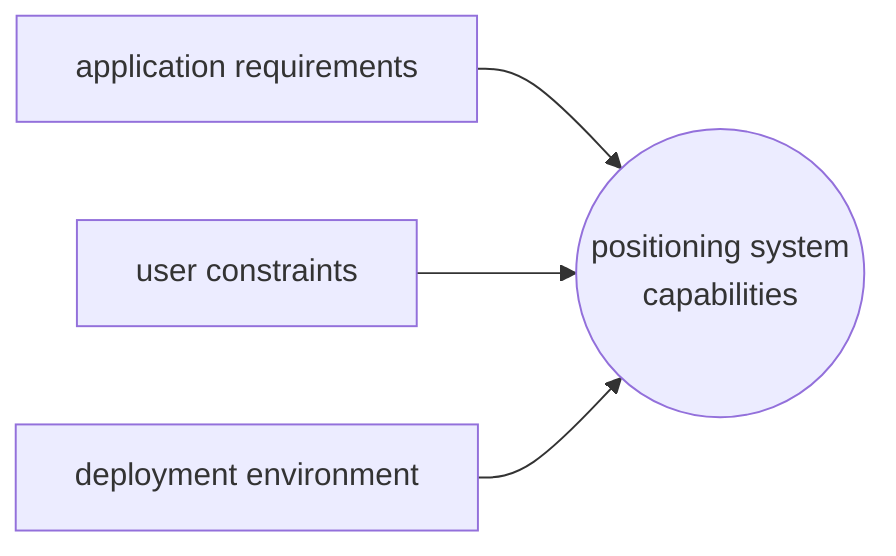

---
aliases:
  - /Base-techniques
  - /1771425122
  - /mobile-systems/1771425122
  - /mobile-systems/Base-techniques
book: "mobile systems"
book_order: 14
date: 2024-06-08
draft: true
images:
  - /1794065306.png
  - /1794065307.png
  - /1794065308.png
show_right_column: true
show_title: true
show_toc: true
slug: 1771425122.md
tags:
  - positioning systems
title: Positioning systems
description: " Introduction on positioning systems"
---

Positioning systems are used to determine the position of a mobile node in a given environment, several approaches are available:

## Distance computation

In order to compute position several methods relies on computing distance between nodes, several approaches are available

- **time of arrival (ToA)** , the distance is computed as $lightspeed*ToA$

- **Received signal strength indication (RSSI)** , the distance is computed by the received signal strength

## Position computation

Position can be computed using several geometrical and non geometrical approaches:

### Time difference of arrival (tdoa)

Given 2 reference points $ref_1,ref_2$ **TDoA** is the set of points where

$$ToA(ref_1)=ToA(ref_2)$$

### Lateration

The position is determined by computing distances from 3 reference points

### Angulation

Based on the fact that the distance between 2 reference points is known, it computes the position using the Carnot's theorem:

$$
\displaylines{
a^2=b^2+c^2-2bc*\cos{\alpha} \\
b^2=a^2+c^2-2ac*\cos{\beta}
}
$$

### Proximity

The current position is determined by the closest reference point to the node, ToA or RSSI can be deployed

### Scene analysis

This is a statistical approach based on the knowledge of the deployment environment and of a dataset of observations made of it (*e.g. RSSI*)

this approach is composed by two phases

- **Preliminary phase** data are collected by observation and monitoring of the environment
- **Operational phase** environment observation are  compared to the collected data to estimate position

## Error sources

Several things can cause error in position measurement such as:

- **Non Line of Sight (NLOS)** a node is not in direct visibility
- **clock skew**  clock are not synchronized
- **fading** due to obstacle presence

## Positioning systems Classification

Positioning systems can be classified in different categories

| CATEGORY          | DESCRIPTION                                                |
| ----------------- | ---------------------------------------------------------- |
| **PHYSICAL**      | position is computed as a numerical value                  |
| **SYMBOLIC**      | position is computed as a logical value (*e.g. city name*) |
| **ABSOLUTE**      | position is computed with a single reference system        |
| **RELATIVE**      | position is relative to some element of the infrastructure |
| **CENTRALIZED**   | one nodes computes positions of the other nodes            |
| **DECENTRALIZED** | each nodes compute is own position                         |

### Characteristics

There are several characteristics to aim for a positioning system

- **ACCURACY** the error range of a measurements
- **PRECISION** the trust degree of a measurements
- **SCALABILITY** how much the positioning system can handle in terms of area of coverage and number of nodes
- **COSTS** cost of maintenance deployment time, client capabilities
- **LIMITATIONS** deployment environment that can host the positioning system (*e.g. indoor/outdoor*)

The deployment dictates what feature is requested from the positioning system together with  application requirements and user constraints

