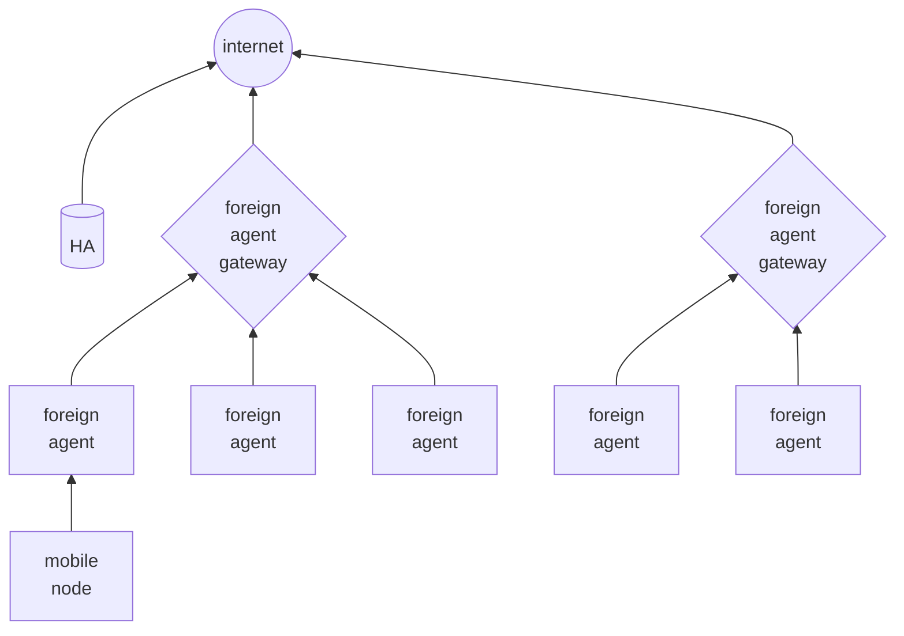

---
aliases:
  - /Hierarchical-mobile-ipv6-(hmip)
  - /1771425137
  - /mobile-systems/1771425137
  - /mobile-systems/Hierarchical-mobile-ipv6-(hmip)
book: "mobile systems"
book_order: 28
date: 2024-06-08
draft: true
images: []
layout: simple
show_right_column: true
show_title: true
show_toc: true
slug: 1771425137.md
tags: []
title: Hierarchical mobile ipv6 (hmip)
---

This solution is based on a hierarchical structure of the infrastructure where foreign agents are associated with a foreign agent proxy (mobile anchor point MAP) that manages handoff procedures between foreign agents

the handoff can be

- **local subnet handoff** local to a MAP
- **MAP domain handoff** between to different MAPs

The mobile nodes organizes themselves in MAPS dynamically based on **service rate** and **mobility rate**
