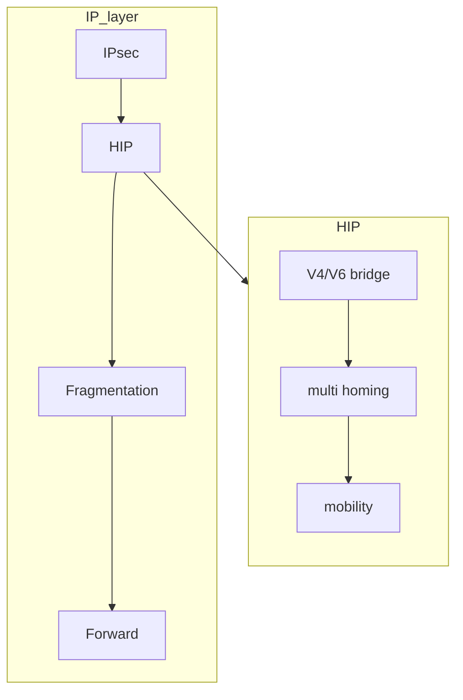

---
aliases:
  - /Host-identity-protocol
  - /1771425138
  - /mobile-systems/1771425138
  - /mobile-systems/Host-identity-protocol
book: "mobile systems"
book_order: 26
date: 2024-06-08
draft: true
images: []
layout: simple
show_right_column: true
show_title: true
show_toc: true
slug: 1771425138.md
tags: []
title: Host identity protocol
---

Complete revision of the ip protocol in order to separate location and identity of a node, the protocol integrates cryptographic Host Identifiers in the ip stack, ipv4,ipv6 interoperability

