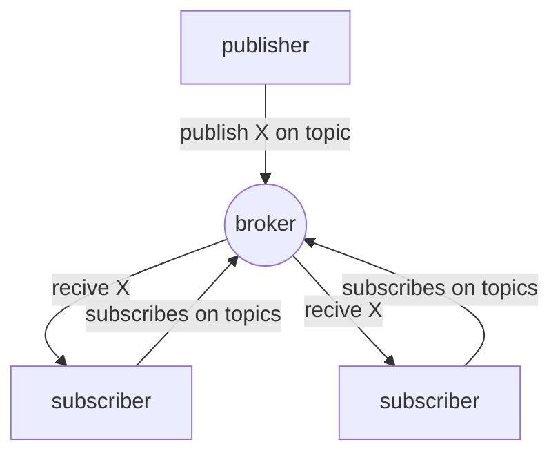

---
aliases:
  - /Pub/sub-model
  - /1771425158
  - /mobile-systems/1771425158
  - /mobile-systems/Pub/sub-model
book: "mobile systems"
book_order: 53
date: 2024-06-15
draft: true
images: []
layout: simple
show_right_column: true
show_title: true
show_toc: true
slug: 1771425158.md
tags: []
title: "Pub/sub model"
---

Model where  nodes plays the role  of publishers and subscribers, publisher send messages and subscribers subscribe to topics and receive messages based on the subscribed topics

PUB/SUB has the following properties

- **space decoupling** No need for the nodes to know each other
- **time decoupling** no need for the nodes to be connected at the same time
- **synchronization decoupling**  no need for the nodes to halt the operation flow to receive communications
