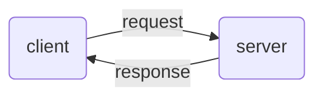

---
aliases:
  - /Request-response
  - /1771425161
  - /mobile-systems/1771425161
  - /mobile-systems/Request-response
book: "mobile systems"
book_order: 56
date: 2024-06-15
draft: true
images: []
layout: simple
show_right_column: true
show_title: true
show_toc: true
slug: 1771425161.md
tags: []
title: Request response
---

Model of interaction where one of the nodes plays the role of the server listening and accepting communications by client machines that makes requests, in this model **only client can start a communication**

Possible interaction with this model can be:

- **pull** actuators request configurations from the server
- **push** sensors send data to the server
