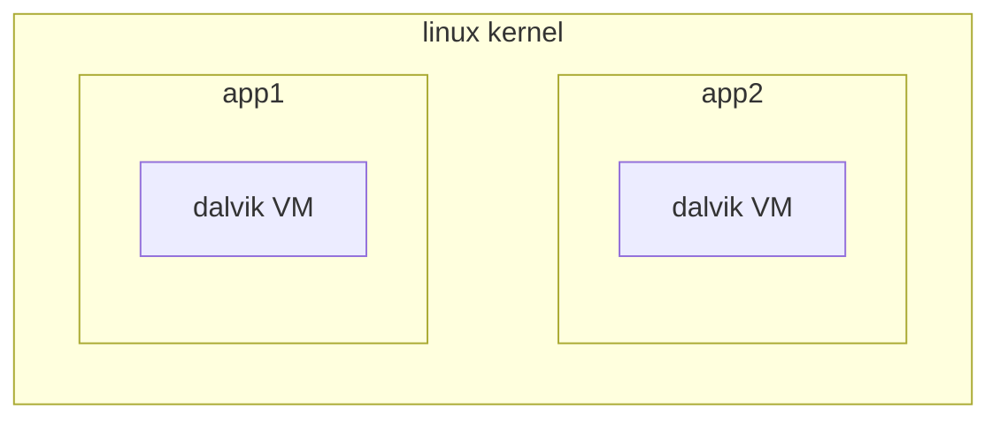

---
aliases:
  - /Android-threading-model
  - /1771425170
  - /mobile-systems/1771425170
  - /mobile-systems/Android-threading-model
book: "mobile systems"
book_order: 40
date: 2024-06-18
draft: true
images:
  - /1794065303.png
layout: simple
show_right_column: true
show_title: true
show_toc: true
slug: 1771425170.md
tags: []
title: Android threading model
---

Android follow a particular threadin model that can be divided in 2 levels, at the kernel level application are executed in different Dalvik VM's and the application is composed by a single java thread that runs the activities




the main thread of the application executes the following looper

```java
while(true){
	Message = m.queue.next();
	if(m!=null){
		m.target.dispatch-message(m);
		m.recycle();
	}
}
```


## Android thread groups

Android defines different group threads with different scheduling priorities

- foreground
- visible service
- background
