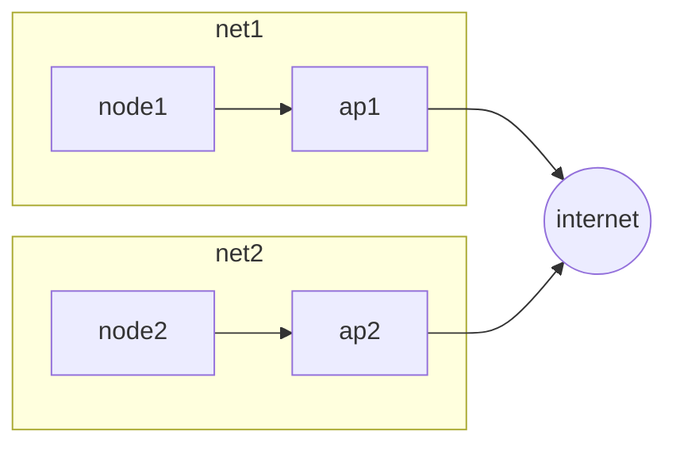
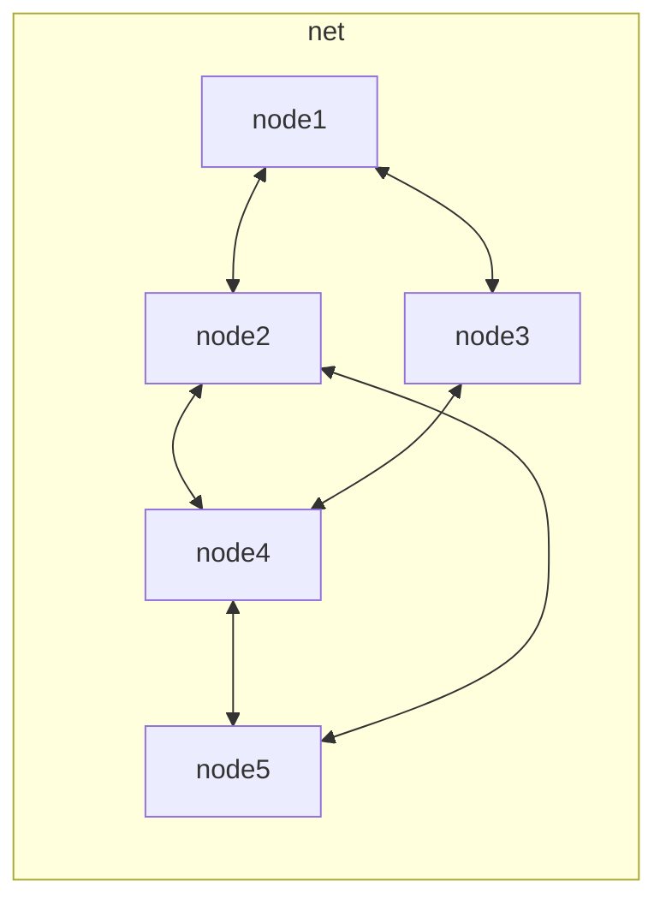

---
aliases:
  - /Wifi
  - /1771425171
  - /mobile-systems/1771425171
  - /mobile-systems/Wifi
book: "mobile systems"
book_order: 2
date: 2024-06-04
draft: true
images:
  - 1794065347.png
layout: simple
show_right_column: true
show_title: true
show_toc: true
slug: 1771425171.md
tags: []
title: Wifi
---

The IEEE 802.11 standard is the most widespread solution for wireless communications, it implements both the [base station mode](/mobile_systems/wireless_communication#base-station-mode) architecture and the [ad hoc mode](/mobile_systems/wireless_communication#ad-hoc-mode) architecture

## Wifi mesh network

The objective is to cover with wireless connectivity technology wide areas like cities with a mesh network

